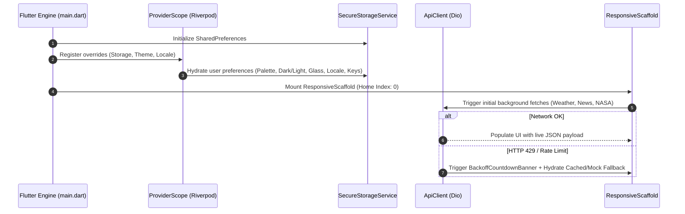

# 🪐 NexusHub — Enterprise Multi-API Intelligence Dashboard

[](https://flutter.dev)
[](https://dart.dev)
[](https://riverpod.dev)
[](https://blog.cleancoder.com/uncle-bob/2012/08/13/the-clean-architecture.html)
[](LICENSE)

**NexusHub** is a production-grade, cross-platform intelligence dashboard and developer utility built with Flutter and Dart. It unifies multiple disparate external REST APIs, native hardware telemetry, custom dashboard widgets, and offline resilience into a cohesive, responsive experience across **Mobile, Tablet, and Desktop** form factors.

Designed with **Uncle Bob's Clean Architecture**, **Material 3 dynamic theming**, and a **user-toggleable Frosted Glassmorphism engine**, NexusHub serves as both a daily command center and an architectural reference for resilient Flutter development.

---

## 📑 Table of Contents

1. [Architectural Overview](#-architectural-overview)
2. [Key Features & Capabilities](#-key-features--capabilities)
3. [App Working Process & Lifecycle](#-app-working-process--lifecycle)
4. [Responsive Design & Navigation](#-responsive-design--navigation)
5. [Frosted Glassmorphism & Visual Design](#-frosted-glassmorphism--visual-design)
6. [Network Resilience & Offline Fallbacks](#-network-resilience--offline-fallbacks)
7. [Directory & Project Structure](#-directory--project-structure)
8. [Native Platform Channels (MethodChannel)](#-native-platform-channels-methodchannel)
9. [Getting Started & Installation](#-getting-started--installation)
10. [Configuration & API Keys](#-configuration--api-keys)
11. [Testing & Quality Assurance](#-testing--quality-assurance)

---

## 🏛 Architectural Overview

NexusHub strictly implements **Uncle Bob's Clean Architecture** divided into three decoupled layers per domain feature:

```
┌─────────────────────────────────────────────────────────────┐
│                    Presentation Layer                       │
│     Screens • Atomic Widgets • StateNotifier (Riverpod)     │
└──────────────────────────────▲──────────────────────────────┘
                               │ (Observes States / Triggers Actions)
┌──────────────────────────────┴──────────────────────────────┐
│                       Domain Layer                          │
│     Entities • Use Cases • Abstract Repository Interfaces   │
└──────────────────────────────▲──────────────────────────────┘
                               │ (Implements Contracts)
┌──────────────────────────────┴──────────────────────────────┐
│                        Data Layer                           │
│   DTOs (fromJson) • Data Sources (Dio) • Repo Impl (Cache)  │
└─────────────────────────────────────────────────────────────┘
```

* **Domain Layer (`domain/`)**: Pure Dart with zero framework dependencies. Contains enterprise business models (`Entities`), abstract contracts (`Repositories`), and single-responsibility business workflows (`UseCases`).
* **Data Layer (`data/`)**: Implements repository interfaces, manages remote HTTP serialization via `Dio`, handles local caching with `SharedPreferences`, and provides automatic offline mock fallbacks.
* **Presentation Layer (`presentation/`)**: Reactive UI driven by Riverpod `StateNotifier`. Maintains explicit state machines (`Initial`, `Loading`, `Success`, `Empty`, `Error`) consumed by declarative widgets without business logic leakage.

---

## 🌟 Key Features & Capabilities

### 1. 🏠 Command Center (Home)
* **Custom Dashboard Studio**: Create, persist, and delete dynamic dashboard cards:
  * **Custom REST API Fetcher**: Configure arbitrary HTTP endpoints, polling intervals, and custom response keys.
  * **Quick Dev Notes**: Scratchpad for developer metrics and quick memos.
* **Quick-Launch Carousel**: One-tap jumps to categorized workflows.
* **Live Micro-Glances**: Embedded real-time weather summary, Astronomy Picture of the Day hero card, breaking news ticker, and daily programmer humor accordion.

### 2. ⛅ Weather Desk & Forecasting
* **Real-time Metrics**: Live temperature, feels-like, humidity, atmospheric pressure, and wind speed.
* **Visual Forecasting Timeline**: 5-day / 3-hour interactive temperature chart rendered with `fl_chart`.
* **Location Intelligence**: GPS auto-detection via geocoding and popular quick-select city chips.

### 3. 🌍 World Atlas & Flag Quiz
* **Global Country Directory**: Searchable atlas covering 250+ nations with population, currencies, capital cities, regions, and high-res SVG/PNG flags.
* **Interactive Flag Quiz**: Gamified flag-matching game with randomized country options, active score counter, and progress tracking.
* **Border Navigation**: Direct jump to neighboring countries via interactive border tags.

### 4. 📰 Global News Wire
* **Multi-Category Feeds**: General, Technology, Business, Science, Entertainment, Sports, and Health.
* **In-App Article Reader**: Clean modal reader with formatted timestamps, article description, and direct external browser launcher.

### 5. 🚀 NASA Deep Space Explorer
* **Astronomy Picture of the Day (APOD)**: High-resolution cosmic imagery with calendar date picker and scientific breakdown.
* **Mars Rover Photos**: Curiosity, Opportunity, and Spirit rover galleries filtered by onboard cameras (`FHAZ`, `RHAZ`, `NAVCAM`, `MAST`) and Martian Sols.
* **Near-Earth Object (NEO) Radar**: Real-time asteroid tracking with hazardous collision trajectory indicators, relative velocities (km/h), miss distances, and estimated diameters.

### 6. 💻 GitHub Developer Studio
* **Profile Insights**: Public repositories count, followers, following, location, and company badges.
* **Repository Explorer**: Real-time star count, fork metrics, language tags, and project descriptions.
* **Commit Timeline & Issues**: Recent commit history with SHA hashes and open/closed issue tracker.

### 7. ☕ Break Room & Jokes
* **Safe-Mode Filtering**: Toggleable content safety filter to ensure workplace-safe humor.
* **Category Filters**: Programming, Miscellaneous, Pun, Dark, Spooky, and Christmas.
* **Two-Part Delivery Reveal**: Interactive setup-and-punchline reveal mechanism with local favorites bookmarking.

### 8. ⚙️ System Configuration & Diagnostics
* **Multi-Palette Theming**: 6 curated color palettes (*Cosmic Indigo*, *Cyber Emerald*, *Solar Amber*, *Neon Crimson*, *Royal Violet*, and dedicated **Matt Black**).
* **Matt Black True Dark Mode**: Instant switch to an authentic `#0D0D0D` deep matte black canvas with `#181818` elevated surfaces, silver-white high-contrast accents, and glare-free aesthetics.
* **Frosted Glassmorphism Toggle**: Live interactive preview switch between high-blur glassmorphic specular surfaces and solid flat surfaces.
* **Internationalization**: 6 languages (English, Spanish, French, German, Hindi, and Arabic with full RTL layout support).
* **API Key Vault**: Seamless toggle between zero-config Demo Keys and custom user tokens with live connection testing.
* **Native Device Telemetry**: Real-time battery status, hardware model, OS build, and haptic engine pulse trigger via `MethodChannel`.

---

## 🔄 App Working Process & Lifecycle



1. **Bootstrapping (`lib/main.dart`)**:
   * Initializes Flutter bindings (`WidgetsFlutterBinding.ensureInitialized()`).
   * Loads `SharedPreferences` asynchronously and binds `SecureStorageService`.
   * Overrides core Riverpod providers (`sharedPreferencesProvider`, `themeProvider`, `localeProvider`) inside `ProviderScope`.
2. **Preference Hydration**:
   * Restores user's selected accent palette (0 to 5, including Matt Black).
   * Restores Dark, Light, or System `ThemeMode`.
   * Restores `isFrostedGlassEnabled` preference.
   * Loads active locale code (with automatic RTL mirroring for Arabic).
   * Loads stored custom API keys or activates demo fallback mode.
3. **Reactive Presentation**:
   * Mounts `ResponsiveScaffold` as root `home`.
   * Automatically adapts between floating frosted navigation (mobile) and categorized navigation rail (desktop).
   * Sub-screens lazy-load their respective data states via Riverpod use cases upon initial activation.

---

## 📱 Responsive Design & Navigation

NexusHub is built to adapt smoothly to any screen width from compact phones (320px) to ultra-wide desktop monitors (1920px+):

| Breakpoint | Form Factor | Navigation Pattern | Features Layout |
| :--- | :--- | :--- | :--- |
| `< 850px` | **Mobile / Phablet** | **Floating Frosted Bottom Bar** (5 clean tabs) + **Segmented Pill Switcher** for sub-domains | Single-column scroll, dynamic aspect ratios, full touch targets |
| `≥ 850px` | **Tablet / Desktop** | **Categorized Frosted Sidebar** with active beacons & sync telemetry | Multi-column grid, persistent sidebar, unconstrained views |

### Mobile Categorization Architecture
To eliminate bottom bar congestion, 8 application modules are mapped into **5 ergonomic mobile destinations**:

```
[0: Home] ──────> Unified Command Center & Custom Dashboard
[1: Explore] ───> [ Weather Desk  |  World Atlas ] (Segmented Switcher)
[2: Feeds] ─────> [ Global News   |  Deep Space NASA ] (Segmented Switcher)
[3: Dev Hub] ───> [ GitHub Studio |  Break Room Jokes ] (Segmented Switcher)
[4: Settings] ──> System Config, Telemetry & Diagnostics
```

Bidirectional state synchronization ensures that triggering navigation from any deep link, card, or notification seamlessly updates both the root category index and sub-tab segment index.

---

## 🎨 Frosted Glassmorphism & Visual Design

NexusHub implements dynamic visual glassmorphism via [GlassContainer](file:///d:/TempWork/MultiTask/lib/core/widgets/glass_container.dart):

```dart
// Dynamic glassmorphic surface
GlassContainer(
  borderRadius: BorderRadius.circular(20),
  padding: const EdgeInsets.all(18),
  child: ContentWidget(),
)
```

* **Frosted Glass Enabled**:
  * Applies `BackdropFilter` with `ImageFilter.blur(sigmaX: 16, sigmaY: 16)`.
  * Renders specular dual-layer gradient borders (light-reflecting top-left to subtle bottom-right).
  * Emits soft ambient drop shadows to elevate cards from background canvas.
* **Solid Surface Mode (Hardware-Friendly)**:
  * Automatically switches to flat, high-contrast Material 3 surfaces without blur overhead for maximum frame rates on lower-spec hardware or user preference.
* **Matt Black Theme Mode**:
  * Selecting the *Matt Black* palette activates a true `#0D0D0D` matte black background across all scaffolds, modals, and screen containers.
  * Surfaces adapt to `#181818` with subtle silver outlines (`0xFFF1F5F9`) to eliminate eye fatigue and deliver an authentic minimalist dark canvas.
* **Universal Contrast Assurance**:
  * All secondary typography, timestamps, subtitles, and badges utilize Material 3 tokens (`colorScheme.onSurfaceVariant`), guaranteeing WCAG AAA contrast in both Dark and Light themes.

---

## 🛡 Network Resilience & Offline Fallbacks

External third-party APIs often suffer from rate limiting (HTTP 429), CORS issues, or connectivity loss. NexusHub integrates multiple defensive mechanisms:

1. **Global Dio Interceptors ([api_client.dart](file:///d:/TempWork/MultiTask/lib/core/network/api_client.dart))**:
   * Transparently injects active API keys from secure storage.
   * Logs outbound requests and inbound response latencies.
2. **Automatic Exponential Backoff & Retry**:
   * Up to 3 automatic retries with exponential backoff on network timeouts or socket exceptions.
3. **HTTP 429 & Rate-Limit Handling**:
   * When an API quota is exhausted, the app triggers a reactive **Backoff Countdown Banner** displaying a non-intrusive cooldown timer.
4. **Graceful Simulated Cache Fallback**:
   * If remote fetching fails or runs in offline demo mode, repository implementations immediately serve high-fidelity cached payloads, ensuring zero empty screens or unhandled exceptions.

---

## 📂 Directory & Project Structure

```
lib/
├── main.dart                               # Application bootstrap & ProviderScope setup
├── core/
│   ├── constants/                          # Global API endpoints & default keys
│   ├── di/                                 # Riverpod dependency injection registry
│   ├── localization/                       # Translations (EN, ES, FR, DE, HI, AR) & RTL provider
│   ├── network/                            # Dio ApiClient, interceptors & backoff banner
│   ├── platform/                           # MethodChannel bridge for device diagnostics
│   ├── storage/                            # SecureStorageService (SharedPreferences wrapper)
│   ├── theme/                              # 5 Color Palettes, AppTheme & ThemeNotifier
│   └── widgets/                            # GlassContainer, ResponsiveScaffold, StateView, Shimmer
└── features/
    ├── home/                               # Command center & Custom Dashboard Studio
    │   ├── data/                           # Custom widget persistence models & repository
    │   ├── domain/                         # Widget entities, enums & use cases
    │   └── presentation/                   # HomeScreen & customizable glance cards
    ├── weather/                            # OpenWeatherMap live desk & 5-day visual forecast
    ├── countries/                          # REST Countries atlas, modal details & flag quiz
    ├── news/                               # NewsAPI headlines by category & article viewer
    ├── nasa/                               # APOD cosmic feed, Mars Rover grid & NEO radar
    ├── github/                             # GitHub developer profile, repos, commits & issues
    ├── jokes/                              # JokeAPI safe humors, punchline reveals & bookmarks
    └── settings/                           # Theme/glass toggles, i18n, API key vault & telemetry
```

---

## 🔌 Native Platform Channels (MethodChannel)

NexusHub interfaces with host operating systems via a dedicated channel:

* **Channel Identifier**: `com.nexushub.app/device`
* **Supported Native Methods**:
  * `getBatteryLevel`: Fetches current battery charge (0–100%).
  * `getDeviceInfo`: Queries hardware model, manufacturer, OS version, and platform architecture.
  * `triggerHaptic`: Invokes system vibration motor with `light`, `medium`, or `heavy` pulse patterns.
* **Cross-Platform Resilience**:
  * When running on Web or Desktop environments without native Android/iOS channel bindings, the platform service activates a fallback telemetry provider, preventing missing plugin exceptions.

---

## 🚀 Getting Started & Installation

### Prerequisites
* [Flutter SDK](https://docs.flutter.dev/get-started/install) (`^3.13.5` or higher)
* [Dart SDK](https://dart.dev/get-dart) (`^3.13.5` or higher)
* Android Studio / Xcode / VS Code with Flutter extension
* Android Device/Emulator, iOS Simulator, or Desktop build toolchain

### 1. Clone the Repository
```bash
git clone https://github.com/your-username/nexushub.git
cd nexushub
```

### 2. Install Dependencies
```bash
flutter pub get
```

### 3. Run Static Analysis & Verification
Ensure the codebase is clean with zero lint or typing errors:
```bash
dart analyze lib
```

### 4. Launch Application
```bash
# Run on connected device or simulator
flutter run

# Run on specific platform targets
flutter run -d chrome        # Web
flutter run -d windows       # Windows Desktop
flutter run -d android       # Android Device/Emulator
flutter run -d ios           # iOS Simulator
```

---

## 🔑 Configuration & API Keys

NexusHub is pre-configured with **Zero-Setup Demo Keys** and automatic simulated fallbacks. You can immediately explore all screens without signing up for external API accounts.

To connect your own real-time production quotas:
1. Launch NexusHub and open **Settings** (`Tune` icon in bottom nav or sidebar).
2. Scroll to **API Key Management**.
3. Toggle off **Demo Keys Mode**.
4. Enter your personal credentials:
   * **OpenWeatherMap**: [https://openweathermap.org/api](https://openweathermap.org/api)
   * **NewsAPI**: [https://newsapi.org/](https://newsapi.org/)
   * **NASA API Key**: [https://api.nasa.gov/](https://api.nasa.gov/) (or use default `DEMO_KEY`)
   * **GitHub Token**: Optional personal access token for higher rate limits.
5. Tap **Save API Keys**, then tap **Test Live Connection** to verify endpoint latency.

---

## 🧪 Testing & Quality Assurance

NexusHub includes automated smoke tests and widget validation:

```bash
# Run full automated test suite
flutter test

# Run tests with coverage output
flutter test --coverage
```

### Quality Metrics Enforced
* ✅ **0 Errors, 0 Warnings**: Fully validated under strict `analysis_options.yaml` rules.
* ✅ **Zero RenderFlex Overflows**: Fully responsive on screen widths from 320px to 4K displays.
* ✅ **Safe Area Compliant**: Bottom clearance dynamically adjusts for navigation bars, camera notches, and home indicator gestures.
* ✅ **WCAG AAA Contrast**: All foreground text elements maintain optimal contrast in both Dark and Light modes.

---

## 📄 License

This project is licensed under the MIT License — see the [LICENSE](LICENSE) file for details.
